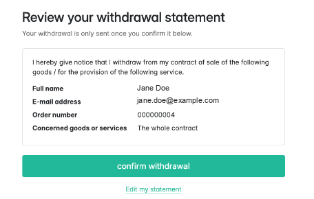
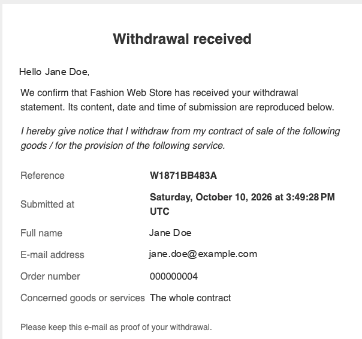
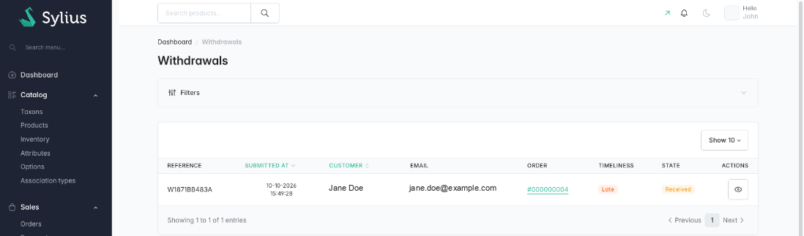
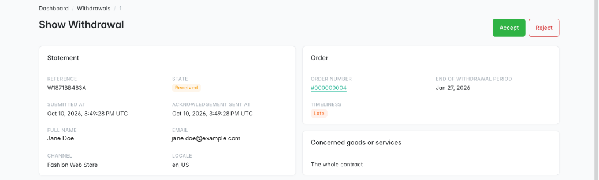

# Sylius Withdrawal Plugin

> Français : [README.fr.md](README.fr.md) <!-- vitrine:lang -->

[](https://github.com/thibmonier/sylius-withdrawal-plugin/actions/workflows/build.yaml)
[](LICENSE)

**The EU "withdraw from contract here" button for Sylius 2.**

Since **19 June 2026**, every online shop selling to consumers in the European Union must offer
a *withdrawal function*: a clearly labelled button letting consumers withdraw from a distance
contract online, followed by a confirmation step and an acknowledgement of receipt on a durable
medium ([Article 11a of Directive 2011/83/EU][art11a], introduced by [Directive (EU) 2023/2673][dir]).

This plugin implements it for Sylius 2.2+, free and open source.

## Features

| Requirement (Art. 11a) | What the plugin does |
|---|---|
| Function labelled *"withdraw from contract here"*, continuously available, easily accessible | Link in the footer of every shop page and button on the customer's order page. No login required. |
| Consumer provides or confirms name, contract and e-mail | Statement form, prefilled for logged-in customers (recital 37) |
| Separate step labelled only *"confirm withdrawal"* | Dedicated confirmation page with a single confirm button; nothing is recorded before it |
| Acknowledgement of receipt on a durable medium with content, date and time | E-mail sent immediately with the full statement and the server timestamp |
| Statement sent within the period is timely | Statements are **never refused**; timeliness is computed and shown to the merchant |

Also included:

- **Partial withdrawal**: logged-in customers pick the order items; guests describe them in free text.
- **Back office**: *Sales → Withdrawals* grid with filters, detail page, *accept* / *reject*
  workflow (Symfony Workflow), deadline and timeliness indicator, and proof that the
  acknowledgement was sent.
- **Order matching** without order enumeration: a guest statement is linked to the order only
  when the number **and** the customer e-mail match, and the response is the same either way.
- **Merchant notification** e-mail to the channel contact address.
- **Official wording** in English, French, German, Spanish, Italian, Dutch and Polish, taken from
  the Official Journal and checked by tests.
- **Customisable** through Twig Hooks; MySQL, MariaDB and PostgreSQL support.

## Screenshots

| Confirmation step | Acknowledgement of receipt |
|---|---|
|  |  |





## Requirements

| | Version |
|---|---|
| PHP | 8.2+ |
| Sylius | 2.2, 2.3 |
| Symfony | 6.4, 7.4, 8.0 |

## Installation

1. Require the package:

    ```bash
    composer require tmonier/sylius-withdrawal-plugin
    ```

2. Register the bundle in `config/bundles.php` (Symfony Flex does it automatically once a recipe exists):

    ```php
    Tmonier\SyliusWithdrawalPlugin\TmonierSyliusWithdrawalPlugin::class => ['all' => true],
    ```

3. Import the configuration in `config/packages/tmonier_sylius_withdrawal.yaml`:

    ```yaml
    imports:
        - { resource: "@TmonierSyliusWithdrawalPlugin/config/config.yaml" }
    ```

4. Import the routes in `config/routes/tmonier_sylius_withdrawal.yaml`:

    ```yaml
    tmonier_sylius_withdrawal:
        resource: "@TmonierSyliusWithdrawalPlugin/config/routes.yaml"
    ```

5. Run the migrations:

    ```bash
    bin/console doctrine:migrations:migrate
    ```

6. Make sure each channel has a **contact e-mail** if you want to receive merchant notifications.

## Configuration

```yaml
# config/packages/tmonier_sylius_withdrawal.yaml
tmonier_sylius_withdrawal:
    period_days: 14        # used to flag late statements; never used to refuse one
    notify_merchant: true  # copy of each statement to the channel contact e-mail
    rate_limit:            # symfony/rate-limiter, on the "confirm withdrawal" step only
        enabled: true
        per_ip: 10         # confirmed statements per IP (IPv6 grouped by /56)
        per_email: 3       # confirmed statements per e-mail (case and "+tag" ignored)
        interval: '1 hour'
        cache_pool: cache.rate_limiter
```

Each confirmed statement records a request and sends e-mails to the address typed in the form,
so the confirmation step is rate limited (sliding window, with a lock so parallel requests
cannot get through together). The limits are deliberately high: the withdrawal function is a
legal obligation, and a consumer who hits them keeps the statement and can confirm it later
(HTTP 429 with a flash message). The form step itself is never limited. Set `enabled: false`
if your infrastructure already throttles these routes.

The withdrawal period starts when the goods are delivered (Art. 9). Sylius does not track
delivery, so the plugin uses the last shipment date, falling back to the checkout completion
date. The deadline is informational.

## Customisation

Every page is built with [Twig Hooks](https://stack.sylius.com/twig-hooks/getting-started):

| Hook | Content |
|---|---|
| `sylius_shop.base.footer.content.menu.help_links` → `tmonier_withdrawal` | Footer link |
| `sylius_shop.account.order.show.content.main.header.buttons` → `tmonier_withdrawal` | Button on the account order page |
| `tmonier_withdrawal.shop.withdrawal.form.content` | Statement form page |
| `tmonier_withdrawal.shop.withdrawal.confirm.content` | Confirmation page |
| `tmonier_withdrawal.shop.withdrawal.done.content` | Acknowledgement page |
| `tmonier_withdrawal.admin.withdrawal_request.show.content.sections#left/#right` | Admin detail page |

E-mail templates can be overridden in `templates/bundles/TmonierSyliusWithdrawalPlugin/email/`.

> [!IMPORTANT]
> If you move or restyle the footer link, keep it **prominent and reachable from every page**,
> and keep the confirm button labelled **only** with the official wording.

## What you still have to do

The plugin provides the technical function. As a merchant you remain responsible for:

- mentioning the existence and placement of the withdrawal function in your pre-contractual
  information and terms (Art. 6(1)(h) as amended);
- processing refunds (for example with [`sylius/refund-plugin`](https://github.com/Sylius/RefundPlugin));
- handling the exceptions of Art. 16 (personalised goods, perishables, etc.) when you review a statement;
- checking national transposition specifics.

This plugin is not legal advice.

## Development

```bash
docker compose up -d mysql mailhog   # or your own MySQL
composer install
(cd vendor/sylius/test-application && yarn install && yarn build)
vendor/bin/console doctrine:database:create
vendor/bin/console doctrine:migrations:migrate -n
vendor/bin/console sylius:fixtures:load -n

vendor/bin/phpunit --testsuite unit
APP_ENV=test vendor/bin/phpunit --testsuite non-unit   # needs a test database with fixtures
vendor/bin/phpstan analyse
vendor/bin/ecs check
```

<!-- vitrine:demo-b2b:start -->
## B2B demo

This plugin is used in the [Sylius B2B demo](https://github.com/thibmonier/sylius-b2b-demo): a Sylius 2.3 shop with fictitious sample data where the B2B plugins work together. The source code, setup and fixtures of the demo are in that repository.

The demo is an example, not a production setup.
<!-- vitrine:demo-b2b:end -->

## License

MIT. See [LICENSE](LICENSE).

[art11a]: https://eur-lex.europa.eu/eli/dir/2011/83/oj
[dir]: https://eur-lex.europa.eu/eli/dir/2023/2673/oj
